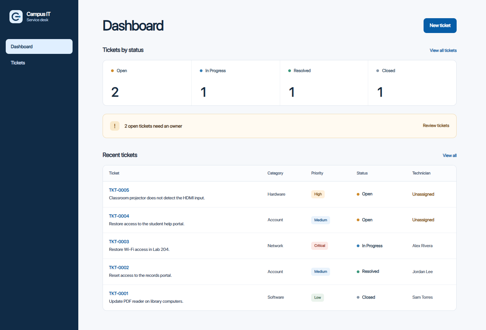

# Campus IT Service Desk

Campus IT Service Desk is a browser-based ticketing prototype built for the **IT Help Desk Ticketing System** exam scenario. It models how a campus IT office can turn reports from staff and students into numbered tickets, prioritize urgent issues, and track who owns each request through resolution and closure.

*Dashboard populated with fictional tickets for the exam demonstration.*

## Run locally

With Node.js 18 or newer, run `npm start` from the repository root and open <http://127.0.0.1:3000>. The project has no npm dependencies to install.

Run `npm test` to check ticket creation, technician assignment, status changes, resolution timing, notes, filters, and dashboard counts.

## Exam walkthrough

1. Select **New ticket** and report a classroom projector failure as a **High** priority hardware issue. Leave the technician field blank. The app assigns a ticket number such as `TKT-0001` and sets the status to **Open**.
2. Return to the dashboard and select **Review tickets** to see unassigned open requests. The ticket list also supports description search, status and category filters, and sorting by date or priority.
3. Open the ticket and try to move it to **In Progress** before assigning a technician. The app keeps it **Open** and asks for an assignment. Save the assignment, move the ticket to **In Progress**, and add a note describing the repair.
4. Mark the ticket **Resolved** and check the resolution date and elapsed days. Close it if the repair worked, or reopen it if the issue returned.

| Transition | What happens |
| --- | --- |
| Open → In Progress | Requires an assigned technician. |
| In Progress → Resolved | Records the resolution date and displays elapsed days since creation. |
| Resolved → In Progress | Reopens the ticket and clears its previous resolution date. |
| Resolved → Closed | Keeps the resolution date and ends the status workflow. |

## Implementation

The interface uses HTML, CSS, and JavaScript modules. Node.js serves the app locally and runs the automated tests. Tickets and notes are saved in the browser’s `localStorage`, where each browser profile and site origin has its own ticket list. Clearing the site’s storage removes those records.

| Path | Purpose |
| --- | --- |
| [`index.html`](index.html), [`tickets.html`](tickets.html), [`ticket-details.html`](ticket-details.html) | Dashboard, ticket list, and ticket detail. |
| [`css/`](css/), [`logo.svg`](logo.svg) | Shared styles and branding. |
| [`js/`](js/) | Page logic, browser storage, and status rules. |
| [`server.mjs`](server.mjs), [`package.json`](package.json) | Local static server and npm commands. |
| [`tests/`](tests/) | Automated ticket workflow tests. |
| [`docs/requirements.md`](docs/requirements.md), [`docs/scenario-analysis.md`](docs/scenario-analysis.md) | Acceptance checks and the exam scenario analysis. |
